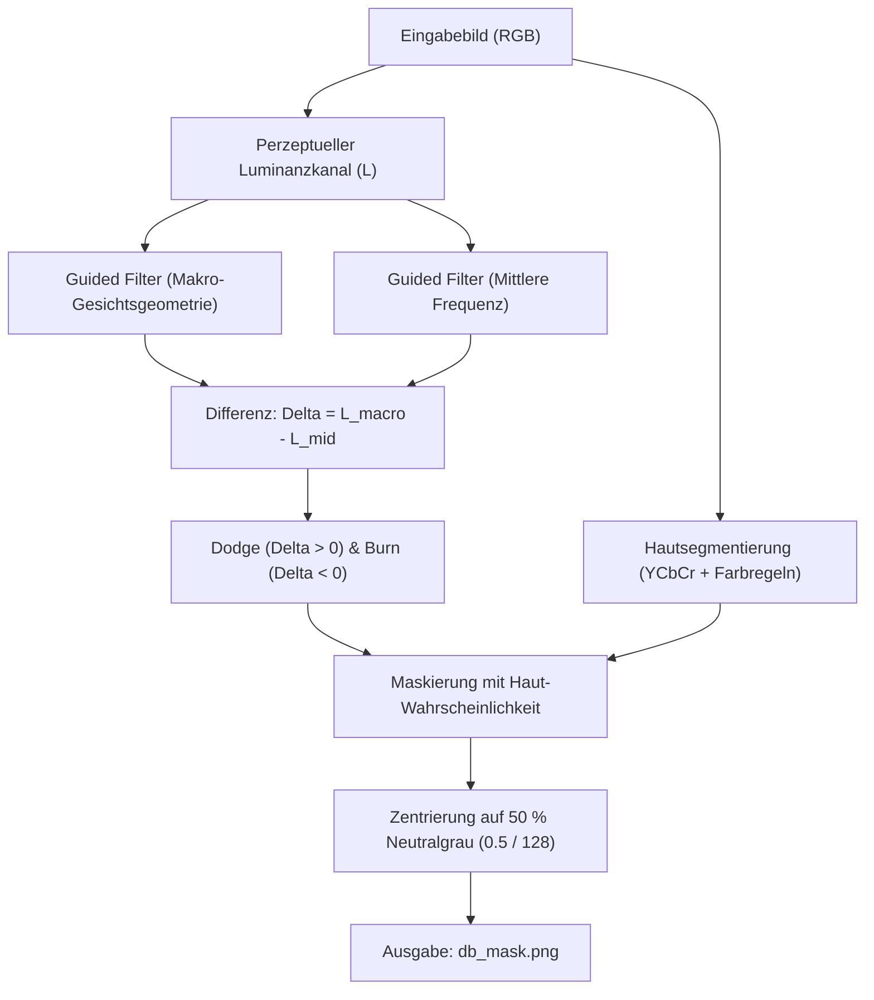

# Photocraft Dodge & Burn Prototype (Linux)

Ein modularer, freier Prototyp zur automatisierten Erstellung von professionellen **Dodge & Burn Korrekturmasken** für Porträts unter Linux, zugeschnitten auf den Workflow mit dem Open-Source-Bildeditor **Photocraft**.

---

## 1. Übersicht & Konzept

Im Gegensatz zu klassischen, geschlossenen Photoshop-Plugins, die als native `.8BF`-Binaries mit unsicheren FFI-Schnittstellen laufen, setzt dieser Prototyp auf einen **Sidecar-Workflow**:

1. **Freie Ressourcen**: Verwendet ausschließlich quelloffene und für nicht-kommerzielle Zwecke frei verfügbare Algorithmen und Modelle (Mathematische Guided-Filter-Zerlegung, $YC_bC_r$-Locus Hautsegmentierung, Soft-Light-Blending).
2. **Photocraft-Kompatibel**: Erzeugt eine standardisierte **50 % Neutralgrau-Ebene (`#808080`)**, die in Photocraft als neue Ebene mit dem Mischmodus **Soft Light (Weiches Licht)** importiert wird.
3. **Porenschutz**: Lokale Unebenheiten (Pickel, Rötungen, Schatten unter Falten) werden im mittleren Frequenzband isoliert und ausgeglichen. Die feine mikroskopische Porenstruktur bleibt vollständig erhalten und wird nicht weichgezeichnet.

---

## 2. Dateien im Prototyp

* `dodge_burn.py`: Das zentrale CLI-Werkzeug und die Berechnungs-Pipeline.
* `synthetic_portrait.py`: Generator für synthetische Testporträts mit definierten Unebenheiten (Dunkle Pickel, Rötungen, Glanzstellen, Poren).
* `test_pipeline.py`: Testsuite zur quantitativen Validierung der Maskenwerte und physikalischen Blend-Kriterien.

---

## 3. Workflow mit Photocraft (Schritt für Schritt)

### Schritt 1: Porträt in Photocraft öffnen
Öffnen Sie Ihr Ausgangsporträt in Photocraft auf der Hintergrundebene. Falls das Bild in einem Rohformat vorliegt, speichern/exportieren Sie es als PNG oder TIFF.

### Schritt 2: Maske mit dem Prototyp generieren
Führen Sie das Skript im Terminal aus:
```bash
python3 dodge_burn.py -i mein_portraet.png -o db_mask.png --comparison vergleich.png
```

Optionale Parameter:
* `--intensity 1.2`: Gesamtstärke der Retusche (Standard: `1.0`).
* `--dodge 1.2`: Spezifische Gewichtung für das Aufhellen dunkler Pickel / Schatten (Standard: `1.0`).
* `--burn 0.8`: Spezifische Gewichtung für das Abdunkeln glänzender Hotspots (Standard: `0.7`).
* `--preview preview.png`: Simuliert die fertige Soft-Light-Überblendung direkt als Bilddatei.

### Schritt 3: Maske in Photocraft importieren
1. Fügen Sie `db_mask.png` als **neue Ebene direkt über dem Porträt** ein.
2. Ändern Sie den Ebenen-Mischmodus von *Normal* auf **Soft Light (Weiches Licht)**.
3. Da 50 % Grau im Soft-Light-Modus neutral ist, bleiben Hintergrund, Haare und unberührte Hautpartien exakt 1:1 unverändert.
4. Regulieren Sie die **Ebenen-Deckkraft (Opacity)** in Photocraft (empfohlen: 60 % bis 85 %), um das Hautbild perfekt natürlich abzustimmen.

---

## 4. Technische Funktionsweise



1. **Separabler Guided Filter ($O(1)$ Komplexität)**:
   * Verwendet die von Kaiming He et al. entwickelte kantenerhaltende Filterung.
   * Über Integralbilder (kumulative Summen) berechnet das Tool selbst 4K-Porträts in wenigen Millisekunden ohne Gradienten-Inversionsartefakte.
2. **Frequenzspaltung**:
   * *Makro-Form*: Globale Lichtführung und Gesichtsrundung.
   * *Blemish-Band*: Punktuelle und flächige Texturschwankungen.
   * *Mikro-Textur*: Feine Poren (wird nicht subtrahiert, bleibt natürlich scharf).
3. **Mathematischer Soft-Light Blend**:
   $$\text{Ergebnis} = \begin{cases} 2AB + A^2(1 - 2B) & \text{für } B \le 0.5 \\ 2A(1 - B) + \sqrt{A}(2B - 1) & \text{für } B > 0.5 \end{cases}$$
   Dabei ist $A$ das Originalbild und $B$ die Neutralgraumaske.
